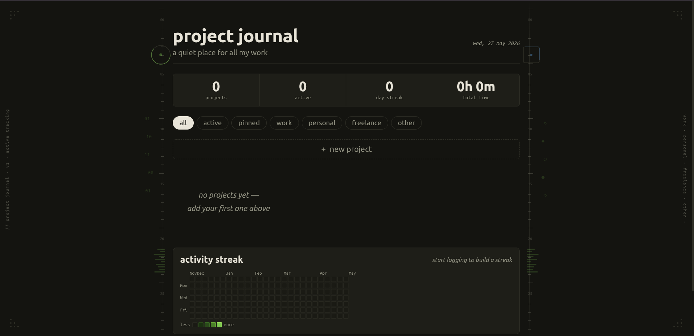

# project journal

> a quiet, offline-first tracker for developers who juggle too many projects at once.

no install. no server. no sign-up. just open the file and start working.

---

## what is this?

project journal is a single `.html` file that lives on your computer. it gives you a calm, notebook-style workspace to track all your coding projects — what they are, where they live, how long you've spent on them, and what you last did before closing your laptop.

it looks like a ruled notebook page. it feels like writing by hand. it works like a smart tracker.

---

## features

### project cards
each project gets its own card stacked vertically on the page. every card holds:

- **name** — displayed in a large handwriting font
- **description** — a short line about what the project is
- **account / email** — which account or identity owns this project
- **repository url** — a clickable link straight to your GitHub/GitLab/Bitbucket repo
- **tag** — categorise as `work`, `personal`, `freelance`, or `other`
- **last touched** — shows how long ago you were in this project (e.g. "2h ago", "3 days ago")
- **inline note** — click to jot a one-line update, like a tiny standup log

### session timer
every card has a live timer so you know exactly how long you've worked:

- **start / pause** — one click to begin or pause a session
- **reset** — clears the current session without losing your total time
- **custom auto-reset** — set how long before the session resets automatically. choose from hours, days, or weeks (e.g. "every 5 hours", "every 3 days", "every 1 week"). if you forget to stop a session, the auto-reset keeps your data clean. a countdown in amber shows exactly when the next reset fires. set to "never" for manual-only control
- **change reset timer** — each card has a ⏱ button so you can update the reset duration at any time without recreating the project
- **total time** — all-time cumulative time logged on the project, displayed in a human-readable format (e.g. `2w 3d`, `4d 6h`, `12h 30m`). survives resets and browser closes

### activity streak
a full-year contribution grid sits at the bottom of the page, like GitHub's contribution graph:

- spans from **december 1st of the previous year** all the way to today — giving you a complete year+ view of your activity
- one cell per day, colour intensity based on how much time you logged that day
  - empty — no activity
  - light green — under 30 minutes
  - medium green — 30 to 60 minutes
  - strong green — 1 to 2 hours
  - deep green — 2 hours or more
- month labels along the top, day-of-week labels on the left
- hover over any cell to see the date and exact time logged
- **streak counter** in the stats bar — counts consecutive days where you logged any time
- each project card also shows a **7-day mini streak** — a small row of dots showing your activity on that specific project over the last week

### tags and filters
- tag every project as `work`, `personal`, `freelance`, or `other`
- filter buttons at the top let you instantly show only: all · active · pinned · work · personal · freelance · other

### pin
- pin your most important projects so they always float to the top of the list
- pinned cards get a green left border to stand out

### stats bar
four numbers always visible at the top:
- total projects
- how many are active right now
- current day streak
- total time logged across all projects

### export & import
- click **export journal as json** to download a full backup — all projects, all timers, the full activity log — as a timestamped `.json` file
- click **import from json** to restore a previously exported backup. this replaces your current data with the imported file, so you can pick up exactly where you left off after reopening the html file

---

## how it works

project journal is built with plain HTML, CSS, and JavaScript. there is no framework, no build step, no backend, and no network connection needed.

**storage** — all your data is saved in your browser's `localStorage` automatically every time you make a change. it persists across browser restarts as long as you use the same browser on the same machine.

**timers** — when you start a session, the app records the start timestamp. when you pause, it calculates elapsed time and adds it to your session and total counters. the streak grid is updated at the same time. a 1-second interval ticks the live timers without re-rendering the whole page.

**auto-reset** — each project stores its own reset duration in milliseconds. when a session starts, the app calculates the exact timestamp when the reset should fire. the tick loop checks this every second. if the reset time has passed, the session is closed and logged automatically.

**streak grid** — every day you log time, the app writes the total ms to a date-keyed log (`pj_activity`). the grid reads from this log to colour each cell, starting from december 1st of last year. the streak counter walks backwards from today counting consecutive days with any logged activity.

---

## user manual

### opening the app
1. download or save `project-journal.html` to your computer
2. double-click the file — it opens in your default browser
3. no internet connection required after the first load (fonts are fetched from Google Fonts once)

### adding a project
1. click **+ new project** at the top of the page
2. fill in the fields:
   - `name` — required, everything else is optional
   - `description` — one sentence about what this project is
   - `account / email` — the email or account associated with this project
   - `repository url` — paste your GitHub or other repo link
   - `tag` — pick work, personal, freelance, or other
   - `session auto-reset after` — pick a number and unit (hours / days / weeks), or "never" for manual-only
3. click **add project** — the card appears immediately

### tracking time on a project
1. find your project card
2. click **▶ start** when you sit down to work
3. the session timer starts counting live
4. click **⏸ pause** when you take a break or switch to something else
5. click **↺ reset** to zero out the current session (total time is kept)
6. the auto-reset fires after your chosen duration — a countdown in amber on the card shows when
7. click **⏱ change reset timer** on any card to update the duration without deleting the project

### writing a note
1. click anywhere on the dashed note area inside a card
2. a text box appears — type your update
3. click anywhere outside the note box to save it
4. use it like a one-line standup: *"finished login flow, next up: dashboard layout"*

### pinning a project
1. click **📌 pin** on any card to pin it
2. pinned cards move to the top and get a green left border
3. click **✕ unpin** to unpin

### filtering projects
click any of the filter buttons below the stats bar:
- **all** — shows everything
- **active** — only projects currently running a session
- **pinned** — only your pinned projects
- **work / personal / freelance / other** — filter by tag

### reading the streak grid
- the grid spans from december 1st of last year to today
- darker green = more time logged that day
- hover over any cell to see the exact date and time logged
- the streak counter in the stats bar shows your current consecutive-day streak

### exporting and importing your data
1. scroll to the bottom of the page
2. click **export journal as json** — a file named `project-journal-YYYY-MM-DD.json` downloads to your computer
3. to restore: click **import from json**, pick your backup file, and confirm
4. all your projects, timers, and activity history will be restored exactly as they were

> **important:** localStorage is tied to a specific browser and file path. if you move the html file, open it in a different browser, or clear your browser data, your saved data may not appear. always export before closing and import when you reopen — treat the json file as your real save file and the html as the app that reads it.

### deleting a project
click the **✕** button (far right in the card actions row) to delete a project. you will be asked to confirm before it is removed.

---

## tips

- **export before closing** — always click export before closing the file. when you reopen it, click import to restore your data. this is your save/load workflow
- **write the note before you pause** — before pausing a session, jot one line in the note field so you know exactly where to pick up next time
- **pin your focus projects** — keep 2–3 pinned at the top so the most important work is always visible
- **set the reset timer to match your workflow** — use hours for focused daily sprints, days for slower-burn tasks, weeks for long-running background projects
- **back up weekly** — export your JSON every week and drop it in a safe folder
- **the streak only counts logged time** — just opening the file does not add to your streak. you have to start and pause at least one session

---

## future improvements

these are planned features that are not yet built:

| feature | description |
|---|---|
| dark mode | toggle between light paper and dark ink themes |
| drag to reorder | manually sort cards by dragging |
| weekly summary | a digest of time spent per tag and per project |
| per-project streak | an individual contribution graph inside each card |
| due dates | add a deadline to a project with colour warnings as it approaches |
| pomodoro mode | a 25-minute countdown timer built into a session |
| GitHub API | auto-fill repo name, language, and last commit from the URL |
| PWA / installable | install as a desktop or mobile app via browser |
| multi-device sync | optional sync via a small backend or cloud storage |

---

## data & privacy

all your data lives entirely on your own machine inside your browser's localStorage. nothing is sent anywhere. there is no account, no server, no analytics, no tracking of any kind.

if you clear your browser's site data or localStorage, your project journal data will be lost — which is why the JSON export exists. use it regularly, and use import to restore it when you reopen the file.

---

## file structure

```
project-journal.html    ← the entire app, open this
README.md               ← this file
project-journal-plan.docx  ← full implementation plan and technical reference
```

---

*built to stay out of your way and let you focus on the work.*
